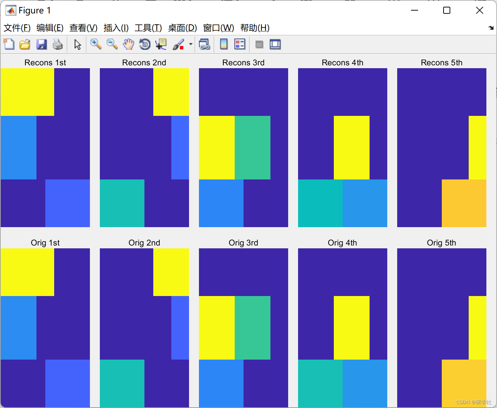
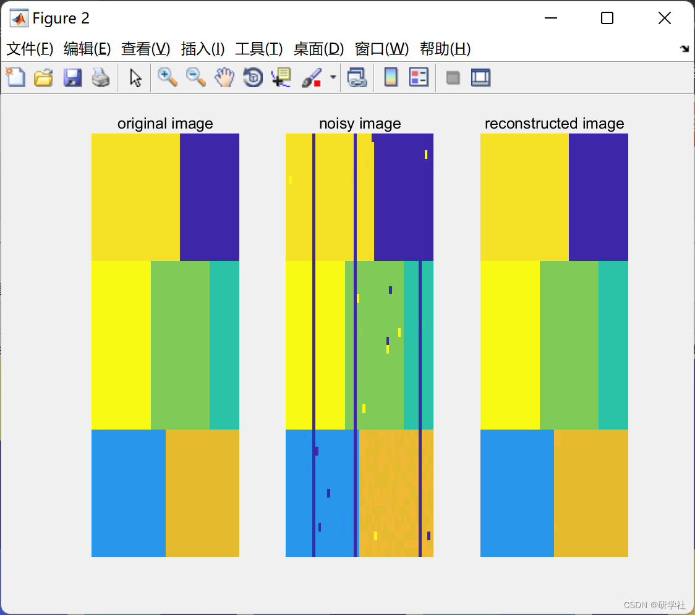

# Hyperspectral Demixing and Image Denoising (Matlab Code Implementation)

​  
Editor
M: Mixture matrix. It is a matrix that contains the spectral features at both ends;
Y: Noise hyperspectral image. This is the image sent to the deconvolution algorithm.
A: Abundance matrix.
S: Sparse noise. It represents pulse noise and line band.
Dh, Dv: Two-dimensional horizontal and vertical finite difference operators.
📚2 Running Results Editing
Editor
Part of the code:
%% showing original, noisy, and denoised image  
figure;  
band=1;  
subplot(131);  
imagesc(img(:,:,band)); axis 'off'; title('original image');  
subplot(132);  
imagesc(noisy2(:,:,band)); axis 'off'; title('noisy image');  
subplot(133)  
imagesc(rec(:,:,band)); axis 'off'; title('reconstructed image');  
end  
%% This is the main function  
function A=funJSTV(M,Y,opts)  
lambda1=opts.lambda1;  
lambda2=opts.lambda2; lambda3=opts.lambda3;  
mu1=opts.mu1; mu2=opts.mu2;iter=opts.iter; m=opts.m; n=opts.n;  
[~,e]=size(M); [~,p]=size(Y);  
Dh=TVmatrix(m,n,'H'); %horizontal total variation  
Dv=TVmatrix(m,n,'V'); %vertical total variation  
D=Dh'*Dh+Dv'*Dv;  
MtM=M'*M;  
A=zeros(e,p);  
B1=zeros(p,e);B2=B1; Y1=Y; B3=zeros(e,p);  
%% main iteration  
for i =1:iter  
for j=1:5  
P=softTh(Dh*(A')+B1,lambda1/mu1);  
Q=softTh(Dv*(A')+B2,lambda1/mu1);  
R=softThL21(A+B3,lambda3/mu2);  
S=softTh(Y1-M*A,1/lambda2);  
RHS=(mu1*(P-B1)')*Dh+ (mu1*(Q-B2)')*Dv+ M'*(Y1-S) + mu2*(R-B3);  
[a,~]=pcg(@afun,RHS(:),1e-15,5);  
A=reshape(a,e,p);  
B1=B1+Dh*(A')-P;  
B2=B2+Dv*(A')-Q;  
B3=B3+A-R;  
A=max(0,A);  
end  
Y1=Y1+Y-M*A-S;  
end  
function y = afun(x)  
X=reshape(x,e,p);  
temp=MtM*X+mu1*X*D +mu2*X;  
%temp=mtimesx(MtM,X,'BLAS')+mu1*mtimesx(X,D,'BLAS');  
y=temp(:);  
end  
end  
%% Soft-thresholding for L21-norm minimization  
function X=softThL21(B,lambda)  
[m,~]=size(B);  
D= spdiags(sqrt(sum(B.^2,2))-lambda/2,0,m,m);  
X=max(0,D)*normrGood(B);  
end  
%% Simple soft-thresholding  
function X=softTh(B,lambda)  
X=sign(B).*max(0,abs(B)-(lambda/2));  
end  
%% Total variation  
function opD=TVmatrix(m,n,str)  
if str=='H' % This will give matrix for Horizontal Gradient  
D = spdiags([-ones(n,1) ones(n,1)],[0 1],n,n);  
D(n,:) = 0;  
D = kron(D,speye(m));  
elseif str=='V' %This will give matrix for Verticle Gradient  
D = spdiags([-ones(m,1) ones(m,1)],[0 1],m,m);  
D(m,:) = 0;  
D = kron(speye(n),D);  
end  
opD=D;  
end  
%% PSNR calculation  
function [cpsnr,psnr]=myPSNR(org,recon,skip)  
%skip : to skip some boundary lines  
org=org(skip+1:end-skip,skip+1:end-skip,:);  
recon=recon(skip+1:end-skip,skip+1:end-skip,:);  
[m, n,~]=size(org);  
if strcmp(class(org),class(recon))  
sse=squeeze(sum(sum((org-recon).^2))); %square sum of error  
mse=sse./(m*n); %mean square error of each band.  
maxval=squeeze(max(max(org)));  
psnr= 10*log10( (maxval.^2) ./mse);  
cpsnr=mean(psnr);  
end  
end  
%% histogram equilization of each band  
function img=myhisteq(img)  
%make each band in zero to one range  
for i=1:size(img,3)  
img(:,:,i)=mat2gray(img(:,:,i));  
end  
end  
%% add Gaussian noise of given SNR  
function [noisy,sigma]=addGaussianNoise(img,snr)  
%This function will add Gaussian noise of given SNR.  
%img is image in size  
noisy=zeros(size(img));  
for i=1:size(img,3)  
band=img(:,:,i);  
varNoise= norm(band(:))^2/(length(band(:)) * (10^ (snr/10)));  
noisy(:,:,i)=band+sqrt(varNoise)*randn(size(band));  
end  
sigma=sqrt(varNoise);  
end  
🎉3 References
🌈4 Matlab code implementation

## Images

<!-- PAYMENT_BLOCK -->

## Get this dataset

- Payment link (Stripe): [Buy now](https://buy.stripe.com/3cs8yP7sY87d0vu9AB)
- Payment QR code: 

<!-- /PAYMENT_BLOCK -->
